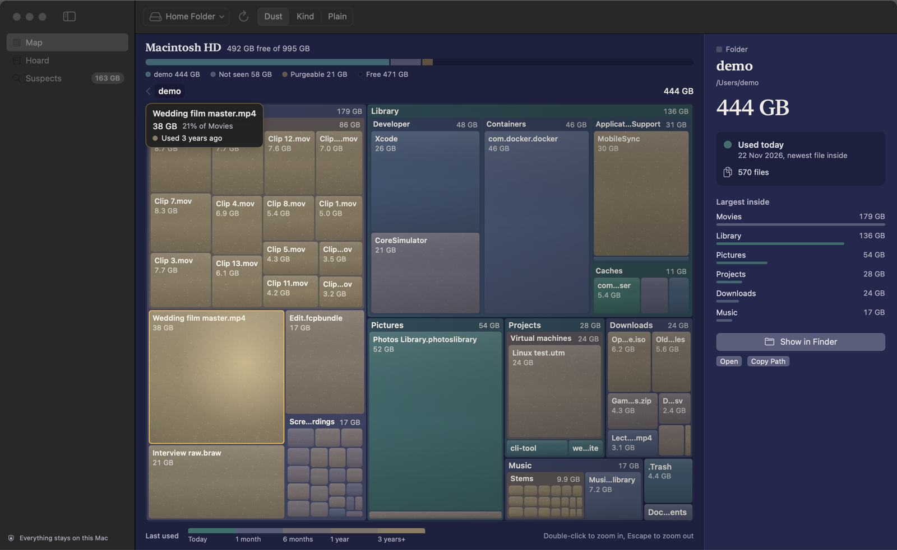
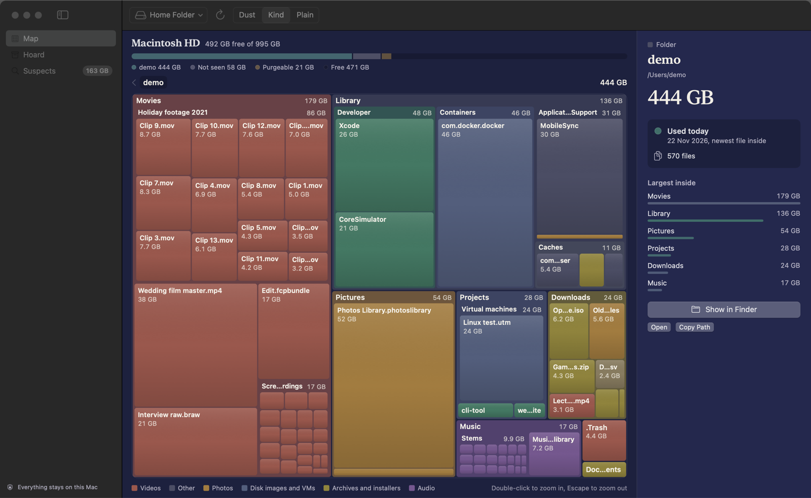
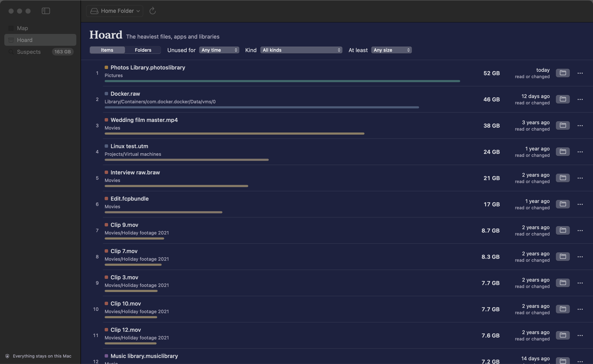
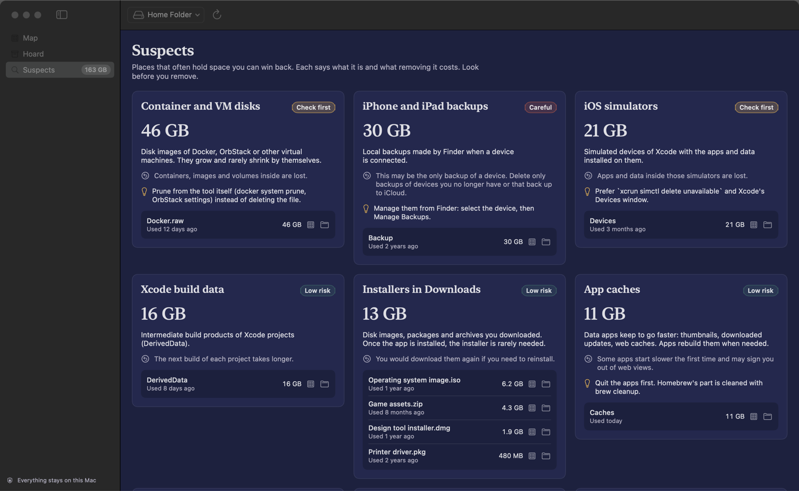
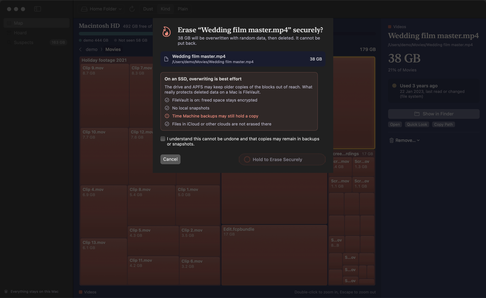

<p align="center"></p>

<h1 align="center">Dyogène</h1>

<p align="center">Shine a light on what your Mac keeps.</p>

Dyogène shows what takes space on your Mac, and what you have forgotten about. It is named
after the Diogenes syndrome (keeping everything), and after the philosopher who lived in a jar
and walked around with a lantern.

It is a cousin of [Hector](https://github.com/0xRD/hector) and
[Gustave](https://github.com/0xRD/gustave): small, local, and careful.



## What you see

- **The map.** Every folder as a tile whose area is its size, nested as deep as space allows.
  With the **Dust** lens, fresh things are teal and things nobody touched for years turn to
  sand, with grain. Big and dusty is where space hides. The **Kind** lens colours by content
  (videos, apps, archives, developer files, caches...). The cursor is a lantern: the tile under
  it lights up and tells its size, share and last use. Double-click to zoom in, Escape to zoom
  out.
- **The Hoard.** The 100 heaviest files, apps and libraries (or folders full of files), with
  when they were last used. Filter by age, kind and size. One click shows any of them in Finder.
- **Suspects.** Places that often hold space you can win back (caches, Xcode build data,
  installers in Downloads, `node_modules`, VM disks, device backups), each with what it is, what
  removing it costs, and a risk level.
- **The gauge.** Where your disk's space goes, including what the scan could not see.

| Kind lens | Hoard |
| --- | --- |
|  |  |
| **Suspects** | **Removing, safely** |
|  |  |

All images come from Dyogène's demo mode: the names and sizes are made up.

## Safe by design

- **100% local.** No network code at all: no updates check, no analytics, no crash reports.
- **Metadata only.** Dyogène reads names, sizes and dates. It never reads what is inside your
  files, and never downloads files that are only in iCloud.
- **No helper, no admin rights.** Full Disk Access is optional. Without it, folders macOS
  protects are skipped and counted as "not seen", instead of popping permission prompts.
- **No accidental removal.** Removing anything happens in a confirmation sheet where Cancel is
  the default, and the confirm button must be held down (1.5 s for the Trash, 2 s to delete
  permanently, 3 s to erase). macOS and your account's standard folders cannot be removed.
- **Honest secure erase.** "Erase Securely" overwrites before deleting, and tells you why that is
  only best effort on SSDs and what may still hold a copy (snapshots, Time Machine, iCloud).
  See [SECURITY.md](SECURITY.md).

## Claude skill

Dyogène ships a command line tool, `Dyogene.app/Contents/Helpers/dyogene`, that prints JSON
reports (`report`, `summary`, `top`, `stale`, `suspects`, `tree`) and can select a file in
Finder (`reveal`). It cannot delete anything.

The skill in [`skill/dyogene`](skill/dyogene/SKILL.md) teaches Claude to use it to find where to
tidy up, without reading your files unless you ask about one, and without ever deleting:
you stay the one who removes things.

```bash
scripts/install-skill.sh
```

## Build

macOS 15 or later, Swift 6 (Command Line Tools are enough).

```bash
scripts/make-cert.sh     # once: a local signing certificate, so Full Disk Access survives rebuilds
scripts/install.sh       # builds and installs /Applications/Dyogene.app
scripts/test.sh          # tests
```

`DYOGENE_DEMO=1` runs the app on made-up data.

## License

GPL-3.0.
